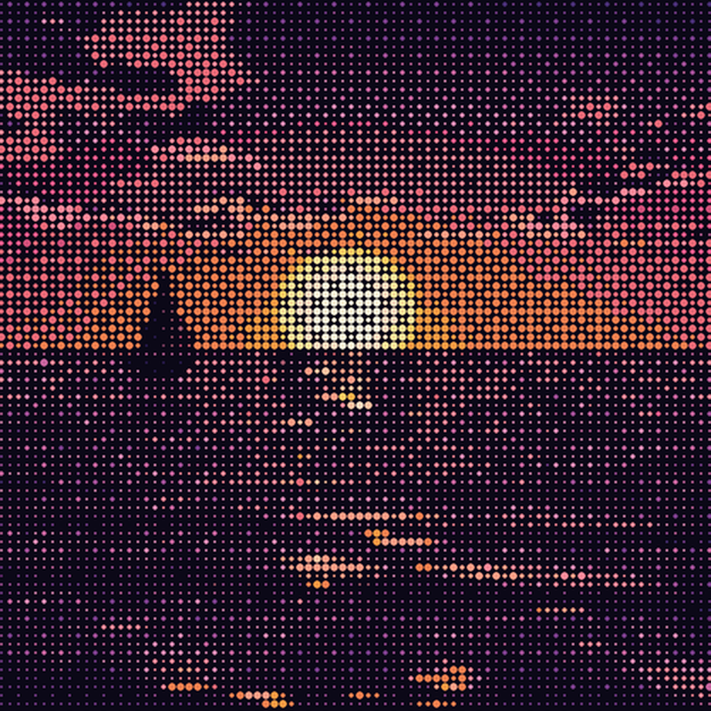
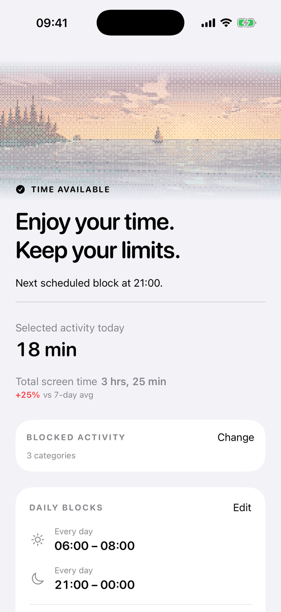
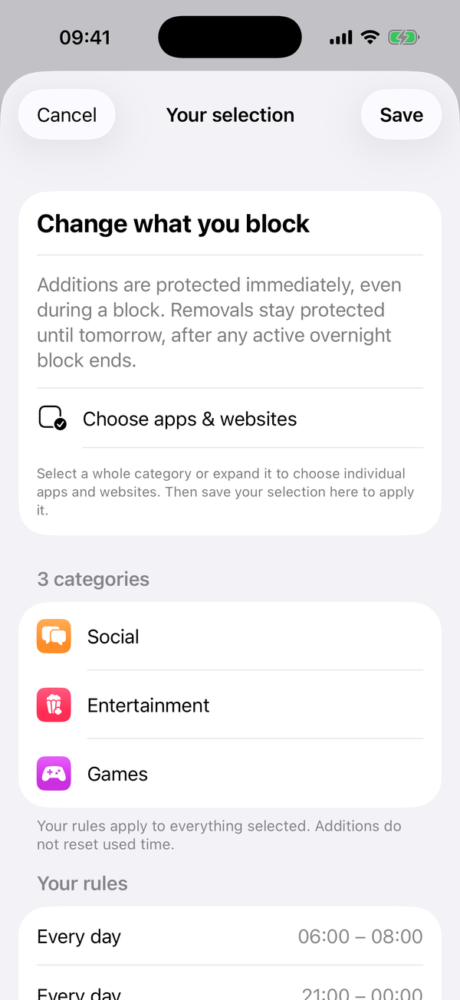
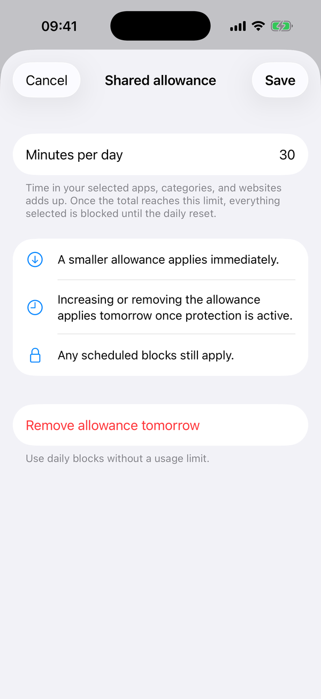

# Daywell

<a href="https://buymeacoffee.com/glebmelnikov"></a>

**Make room for your day.**

Daywell is a free, open-source iPhone app that helps you spend less time doomscrolling. Choose the apps, categories, or websites that distract you, then set a blocking schedule, a shared daily allowance, or both.

Your selections and activity stay on your device. No account, subscription, ads, or analytics. Built with SwiftUI for iOS 17.4 and later.

[Get it on the App Store](https://apps.apple.com/app/id6820666833) · [Support](https://daywell-support.tunedtoast2.chatgpt.site/support.html) · [Privacy](https://daywell-support.tunedtoast2.chatgpt.site/privacy.html) · [Report an issue](https://github.com/watchmesink/daywell/issues)

## Screenshots

Dashboard, activity selection, and shared allowance. Simulator captures with sample data, in light and dark mode.

<p>
  <picture>
    <source media="(prefers-color-scheme: dark)" srcset="docs/screenshots/dashboard-dark.png">
    
  </picture>
  <picture>
    <source media="(prefers-color-scheme: dark)" srcset="docs/screenshots/selected-apps-dark.png">
    
  </picture>
  <picture>
    <source media="(prefers-color-scheme: dark)" srcset="docs/screenshots/shared-allowance-dark.png">
    
  </picture>
</p>

## How it works

Grant Screen Time access, choose what to block in Apple's private picker, and activate your routine. New users start with a 30-minute shared allowance and no scheduled blocks.

- Add up to seven daily blocking windows, including overnight schedules.
- Share one daily allowance across your selected apps, categories, and websites outside those windows.
- See today's selected activity alongside total screen time and its change against the previous seven-day average.
- Tighten limits immediately. Changes that relax protection wait until the next day, after any overnight block ends. You can review or cancel them under Upcoming changes.

For example, 10 minutes in TikTok and 20 minutes in X use the full 30-minute allowance. Both apps are then blocked for the rest of the day.

Daywell relies on iOS for blocking and usage reports, so updates can be delayed. Uninstalling the app or revoking Screen Time access removes protection. See [architecture and limitations](docs/ARCHITECTURE.md) for the details.

## Build and test

For a personal build, you need macOS, Xcode, a paid Apple Developer membership with Family Controls access, and an iPhone running iOS 17.4 or later. There are no third-party runtime dependencies.

1. Copy `Config/Local.xcconfig.example` to `Config/Local.xcconfig` and set your Team ID, bundle prefix, and App Group. This file is ignored by Git.
2. Open `Daywell.xcodeproj`, select the **Daywell** scheme, and choose your connected iPhone.
3. Configure signing, Family Controls, and the shared App Group for the app and its four extensions, following the [signing guide](docs/SIGNING.md). Build and run.

Run the rule tests and compile the app and extensions for the simulator:

```sh
bash scripts/check.sh
```

Use `swift test` for just the portable tests. The Xcode project is checked in; run `xcodegen generate` after changing targets or adding source files.

The simulator is useful for interface checks. Verify Screen Time enforcement on a physical iPhone using the [device checklist](docs/DEVICE_VALIDATION.md). [Validation results](docs/VALIDATION.md) and the [App Store release kit](publishing/README.md) cover testing and distribution in more detail.

## License

The source and app icon are [MIT licensed](LICENSE). The ocean-sunset artwork is adapted from [ascii.rest](https://ascii.rest/ocean-sunset/) by bas3line under the MIT license; see [artwork attribution](docs/ARTWORK.md).
